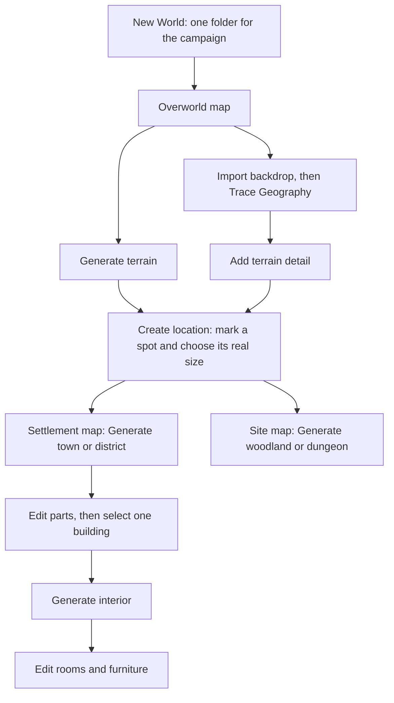

# Atlas: what to do, and what happens next

Atlas lets you make maps at different scales and connect them. You can generate a starting point, keep the bits you like, and edit the rest.

The confusing part is that **the available actions depend on the map you're on and what you've selected**. Read the map name and the bold target beside the generation buttons before clicking anything.

**For your first session, read the overview and follow [the walkthrough](#2-first-walkthrough-world--town--building-interior).** The rest is reference for when you need it.

- [Start with an existing map picture](#3-starting-from-a-map-picture-you-already-have)
- [Understand the changing buttons](#4-what-the-changing-generation-buttons-mean)
- [Start with just a town, woodland or dungeon](#5-other-starting-points)
- [Find a fix when you're stuck](#10-when-something-seems-wrong)

## Start here: the whole flow

You can also start with a standalone town, woodland or interior. A complete continent is optional. A **region** map is an optional closer view between the overworld and a town or site.

**The everyday loop:** choose a map → select the thing you want to work on → generate or edit → undo or try another → keep going. Generation is kept immediately; there is no separate approval step for ordinary generation.

## 1. Know what the names mean

| Name | What it actually means |
|---|---|
| **World** in New World / Open World | The campaign folder. It holds all your maps, notes and used art. |
| **world** map | One large overview map inside that folder. New World starts you with an Overworld map. |
| **region** map | Closer geography: part of a continent, a kingdom or a travel area. |
| **settlement** map | Town or city scale. This is where town and district generation works. |
| **site** map | One outdoor location or dungeon. Choose Woodland or Dungeon here. |
| **interior** map | Rooms inside a building, or a standalone indoor location. |
| **Area** | A drawn shape: land, water, district, building or floor. Its role tells Atlas what it means. |
| **Generated result** | A set of objects made together. Atlas initially selects it as a group. |
| **Place** | A name, category and notes attached to selected map objects. It can link to an interior. Creating a Place alone does not generate another map. |

Map type changes the tools you get. Zooming closer does not turn a world map into a settlement map.

### Where things live

- **Maps:** choose an existing map; create a new one; import a backdrop; trace geography.
- **Map canvas:** draw, select and move things. **Fit** beside the map name gets the whole map back on screen.
- **Generation strip beside the map:** generate the current target, try another result, or edit its parts.
- **Inspector:** details of your selection. Generation **Settings…** opens here; **Back to selection** returns to object details.
- **Layers:** control which contents you can see and edit. The default Base layer is enough to start.
- **+ Places:** open your named locations and their notes.
- **Assets:** choose props, textures and the art used by world themes.
- **Settings:** art-pack setup and the optional agent connection. Generator settings are beside the map.

**The top-bar + Map button opens another map view.** To create an actual new map, use **Maps → New Map → Create Map**.

## 2. First walkthrough: world → town → building interior

Do this once with defaults. Leave custom art and detailed settings until the route makes sense.

### A. Make some geography

1. Click **New World** and choose a fresh folder for this practice world.
2. The **Overworld** map opens. Look at the row **directly below “Overworld (world)”, Fit and Map…** in the center panel. On a fresh map, that row says **Whole map** and has **Generate terrain**. Click it.
3. Wait for generation to finish, then click **Fit** beside the map name.
4. Use **Try another** if you dislike the result. Leave it alone when you like it: it is already part of the map.

**You should now have:** a world map with land, terrain and rivers. This has not created towns or building interiors.

**If your screen already says “world result” / “Try another”:** Atlas has a saved generator run for this map, so it shows the controls for that run instead of the first-generation button. **Try another** rerolls it. **More… → Make independent** ends that run and keeps its objects; the row then offers generation actions again (**Generate terrain** or **Add terrain detail**, depending on the land present). This was the workaround for the blank “world result” screen encountered while following this guide. It also ends the old result's reroll link, so do not use it just to dismiss a menu or change your view. Undo restores the run.

If the canvas is blank, try **Fit** first. A saved run does not prove that its contents are currently visible or that generation produced a useful map.

### B. Turn one spot into a town map

1. Find a patch of land where you want a town.
2. Choose **More tools… → Create location**.
3. Drag a rectangle around that spot. This chooses where the closer map belongs.
4. In the controls that appear, enter a name and choose **settlement**.
5. Set **Width (mi)** and **Height (mi)** to **1** each for this practice run. A rectangle dragged on a continent can accidentally cover a huge area; these fields set its actual size.
6. Click **Create Child Map**, then **Fit**.

**You should now have:** a separate town-scale map, nested under Overworld in Maps. It inherits the geography at that spot. It does not have buildings yet.

### C. Fill a district with buildings

1. Choose **Draw… → District**.
2. Click a few points around a modest patch of dry land, then press **Enter** to finish the shape.
3. Check the generation target: it should be your selected area. Click **Generate district**.
4. Wait for buildings and streets to appear. Use **Try another** if you want another arrangement.

You can also generate a whole town without drawing a district. With no smaller target selected, **Generate town** fills the map's available area. Districts let you work on one neighborhood at a time.

For a more deliberate town, draw major streets, water, walls and landmark buildings first. The generator fills around them. You do not need to do all that for this practice run.

**You should now have:** buildings on your settlement map, selected together as a generated result.

### D. Go inside one building

1. With the town result selected, click **Edit parts**.
2. Choose **Select**, then click one building. You are now selecting that building rather than the whole town.
3. The generation controls should offer **Generate interior**. Click it.
4. Atlas creates and opens an interior sized to that building, with generated rooms. It also creates a linked Place if the building needs one.
5. To change individual rooms, select the interior result, click **Edit parts**, then select a room. Choose its purpose and use **Furniture… → Fewer / More / Rearrange**.
6. Click your town in **Maps** to go back outside. Select the same building again to use **Open interior**.

**You should now have:** Overworld → town → building interior in your map tree. The interior is saved separately, connected to its building. Undoing the initial interior-generation action removes that new interior and returns you to the town.

## 3. Starting from a map picture you already have

A backdrop is a picture. Atlas cannot work around its painted coastlines, rivers or buildings until those features also exist as editable shapes.

### For a world or regional map

1. Open the map you want to use.
2. In **Maps**, enter the picture's **Backdrop width** and choose **mi** or **ft**. This is the real width represented by the entire picture.
3. Click **Import Backdrop Image**. On an empty map, the map size follows the image size.
4. Click **Trace Geography**. Atlas proposes land, water and river shapes.
5. Review the preview. Use **Sample water colour**, adjust sensitivity, or paint land/water corrections where labels and artwork fooled it. You can add or remove river paths too.
6. Click **Accept Geography**. Until then, Cancel leaves the map unchanged.
7. To add generated terrain while following that coastline, use **Add terrain detail**. If the backdrop is still selected, choose Select and press Esc to clear the selection first.
8. Continue with **Create location** as in the walkthrough.

**Import image → review trace → accept geography → add terrain detail** are separate steps. Importing the image alone does not do the rest.

If you know a distance inside the picture rather than its full width, use **Set Real Size (Calibrate)**: drag a line over that distance, enter its real length and units, then click **Apply**. Set the scale before tracing and developing locations.

### For a town or floor-plan picture

Use it as a reference and draw the meaningful shapes yourself: streets, water, districts and buildings on a settlement; floors, walls and doors in an interior. **Trace Geography** detects geography, not room layouts or a city's building plan.

If you already have vector outlines, **Maps → Import SVG** can turn supported shapes into editable areas and paths. Set the drawing's real width and assign roles in the import dialog.

## 4. What the changing generation buttons mean

The bold name in the generation strip is the target. Check it whenever a button seems to have disappeared.

| Current target | What you can do |
|---|---|
| A blank world/region | **Generate terrain**. |
| Authored or traced land on a world/region | **Add terrain detail**, following existing land. |
| A settlement or selected district | **Generate town** or **Generate district**. |
| A site | Choose **Woodland** or **Dungeon**, then generate. |
| An interior | **Generate rooms**. |
| An existing generated result | **Try another**, **Settings…**, **Edit parts**. |
| One building on a settlement | **Generate interior**, or **Open interior** if it already has one. |
| One generated room while editing parts | Room purpose and **Furniture…** controls. |
| An unrelated object or mixed selection | Generation may be unavailable. Select the intended result or a suitable area. |

### Generate, apply, reroll, keep

- **Generate…** creates the first result and keeps it immediately.
- **Try another** generates another version using a new seed. Your intentionally edited parts stay put.
- **Apply changes** uses your changed generator settings with the existing seed.
- **Settings…** only changes the draft settings. It does not change the map until you generate or apply them.
- **More… → Rearrange furniture only** changes dressing while keeping an indoor layout.
- **More… → Make independent** keeps the result and ends its regeneration link. You do not need this just to keep a result you like.
- **Undo** reverses a completed generation, reroll or edit.

The **seed** is the number used to make a repeatable arrangement. Leave it alone unless you want to repeat a particular starting point.

### Protecting the bits you like

Use **Edit parts** to reach individual generated objects. Moving or editing a part preserves it during later attempts. Creating a **Place** from generated objects protects those linked objects too; giving a building an interior also preserves the building.

To hand an edited part back to its generator, select it and choose **More… → Allow regeneration of this part**. **Done editing parts** returns to working with the group.

If a result is hard to select, look in **More… → Generated results**, or **Settings… → Find a generated result**.

## 5. Other starting points

### Just make a woodland or dungeon

1. In **Maps → New Map**, enter a name, choose **site**, leave the parent as **(no parent)**, then click **Create Map**.
2. Choose **Woodland** or **Dungeon** beside the map.
3. Set clearing count/tree density, or layout/room count/purpose. Defaults are enough for a first attempt.
4. Click **Generate woodland** or **Generate dungeon**. Use **Try another** until you have something useful.

Woodland settings add a stream or pond and custom entrances. Without custom entrances, trails enter at the north and south edges. Indoor settings include corridor width in grid squares, mirroring, theme and dressing density.

### Just make an interior or town

Create a standalone **interior** or **settlement** through New Map, then use **Generate rooms** or **Generate town**. You can generate on a blank map without drawing a footprint or setting up extra layers first.

### Connect maps deliberately

**Create location** cuts a chosen part of the current map into a closer child map, at the size you specified, with inherited geography. The **Parent** dropdown in New Map attaches a fresh map under another map; it does not choose a patch of geography to inherit. Use Create location when you mean “develop this spot.”

Click maps in **Maps** to navigate. **Map… → Zoom-through** can switch between connected parent/child views as you zoom. Turn it off while learning if map changes are disorienting.

When you change parent geography, a child may show **parent changed**. **Pull** / **Pull from parent** refreshes its untouched inherited shapes and preserves your manual edits. Drawing in a child does not automatically redraw the parent. These are connected maps with their own contents.

## 6. Editing and adding notes

| Task | How |
|---|---|
| Pan | Hold Space and drag, or drag with the middle mouse button. |
| Zoom | Mouse wheel over the map. |
| Recover your view | **Fit** beside the map name; **Map… → Fit Selection** for selected objects. |
| Select one generated object | Select its result → **Edit parts** → click the object. |
| Clear a selection | With Select active and the map focused, press **Esc**. While editing parts, the first Esc returns to the group; press again to clear it. |
| Move / resize / rotate | Drag selected contents, the box handles, or the rotation handle above the box. |
| Draw a shape or line | Choose a tool under **Draw…**, click points, then **Enter**. **Esc** cancels the unfinished drawing. |
| Fix an outline | Select one area/path/wall → **More… → Edit outline**. |
| Undo a drawing point | **Backspace** or **Ctrl+Z** while drawing. **Ctrl+Y** restores a point. |
| Undo a completed edit | **Undo** or **Ctrl+Z**. Unfinished drawing points take priority. |

To name something important: select its objects → click **+ Places** → enter its name/category → **Create Place**. Select its entry to edit **Notes** and **GM Notes**. Notes are ordinary content; keep secrets in GM Notes or mark the Place **GM Only**. The Place list searches the current map.

## 7. Art comes after the map works

Atlas has built-in art, so you can skip packs entirely while learning.

For your own art: **Settings → Register folder** for loose images, or **Import Dungeondraft pack** for a supported pack. Unzip downloaded image collections first. Registration makes the art available to browse; it does not place anything on the map.

Then open **Assets**, select art, and use **Stamp on map** to place it. Select an area, path or wall and use **Texture selection** for repeating art. Check the pack's pixels-per-square setting if props appear much too big or small.

A **World theme** assigns art to roles such as trees, furniture and roofs. Choose that theme under the generator's **Settings…** and generate/apply. Assigning a role alone does not repaint existing output. The top-bar **Theme: Dark/Light** only changes the editor's appearance.

Used art is copied into the world folder. Merely registering a pack does not copy the entire pack into it.

## 8. Travel, players and exports

**Travel:** choose **Measure**, click along a route, then Enter to finish. Enter speed and departure time. Enable **Daily schedule** for travel windows and overnight stops; **Watch/camp marks** shows the stops along the route. Measurements are temporary and do not become saved map content or exports.

**Player display:** open **Player window**, choose its map, then **Send my view** to copy your camera. The player map can stay put while you work elsewhere. Labels, grid and fullscreen display have their own controls.

**Fog:** enable fog for the map you are editing, choose **More tools… → Fog**, and paint Reveal or Hide. The GM sees translucent cover; the player sees solid cover. This is manual reveal, not automatic vision from lights or token movement.

**Export:** click **Export**, choose whole map / selection rectangle / custom rectangle, set pixels per square, then **Save player PNG** or **Save Universal VTT**. Private content is excluded. **Fog is omitted**, so an export includes unrevealed public map contents. Use the player window when you want the current fog cover. UVTT includes walls, doors and lights; its report calls out secret doors to configure after import.

## 9. Saving and moving work

Edits autosave after about two seconds. Check **Saved** in the top bar; use **Save** before closing or copying the folder. **Open World** opens the campaign folder, not an individual map file. Keep the whole folder together, including maps and assets. Panel arrangements are stored separately on the computer.

**World transfers** is for moving work between campaign folders:

- **Fork:** a separate copy of the whole world in an empty folder.
- **Copy / Move:** transfer a map and its descendants. A move changes the source; undo restores the source side but does not remove the target copy.
- **Linked copy:** keep counterparts for later manual sync. **Preview linked sync** shows incoming changes and lets you choose Mine/Theirs for conflicts. Sync each linked child separately.

You can leave transfers and the agent server alone during ordinary mapmaking.

## 10. When something seems wrong

| What you see | What to check |
|---|---|
| “I want a building, but clicking selects the entire town.” | Click **Edit parts**, then select the building. |
| “Generate interior disappeared.” | You need one building selected on a **settlement** map. |
| “I imported a map, but the generator ignores the coast.” | The image needs traced or manually drawn geography. For a world/region, use **Add terrain detail** after tracing. |
| “I can't find Generate town.” | Check the map type and selection. It belongs on **settlement** maps; a selected district offers Generate district instead. |
| “The guide says Generate terrain, but I only have Try another.” | You're in the controls for a saved generator run. **Try another** rerolls it. **More… → Make independent** keeps its objects and ends that run, returning to generation actions. See the note in walkthrough A before using it. |
| “Changing settings did nothing.” | Click **Apply changes** for an existing result, or Generate for a new one. |
| “My town is enormous / buildings are tiny.” | Check real map dimensions. For practice, use a one-mile-square settlement. Zoom changes the view, not the real size. |
| “The map changes when I zoom.” | Turn off **Map… → Zoom-through**. |
| “I can't draw, move or generate.” | Check **Layers** for a visible, unlocked layer. A whole group may need all its layers unlocked before moving. |
| “Generation says the area is blocked or too small.” | Use a larger connected area, fewer rooms/clearings, or fewer obstacles. A solid manual interior wall needs a door to connect across it. |
| “Town generation rejects this region.” | The generation footprint must fit the 16 km² limit (about 6.18 sq mi). Draw a smaller district. **Highlight obstacles** helps explain blocked space. |
| “I lost the map.” | Click **Fit**, then verify the map name in Maps. |
| “An older world has stranded contents or a missing boundary.” | Open **Maps → Repair Existing World…**, read the repair details, then apply. It is undoable; unresolved source boundaries may need a selected replacement area. |

If you're stuck, check these three things first: **Which map am I on? What is selected? What does the generation target say?**
